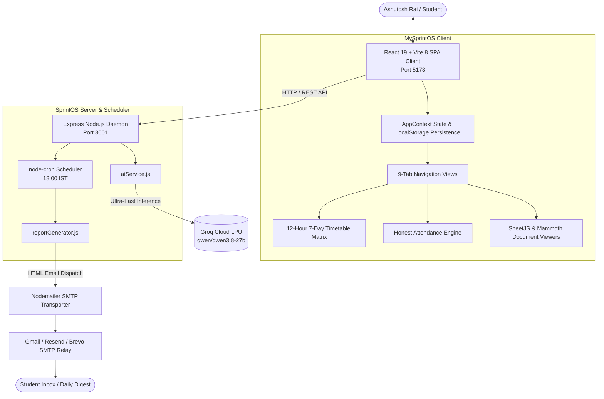

# ⚡ MySprintOS — Academic Command Center & Intelligence Engine

<div align="center">


**Purpose-built for Ashutosh Rai — B.Tech Computer Science & Engineering (Batch 2024–28, Elon Musk Cohort, Semester 5, Sprint 2)**

*Transforming university academia from static schedules into a high-performance productivity engine, intelligent journal, and automated transactional intelligence hub.*

</div>

---

## 📑 Table of Contents

- [Overview & Vision](#-overview--vision)
- [Core Feature Highlights](#-core-feature-highlights)
  - [1. 7-Day 12-Hour Timetable Matrix](#1-7-day-12-hour-timetable-matrix)
  - [2. Mathematically Honest Attendance Engine](#2-mathematically-honest-attendance-engine)
  - [3. Groq LPU™ AI Academic Executive Synthesis](#3-groq-lpu-ai-academic-executive-synthesis)
  - [4. Automated SMTP Transactional Email Dispatcher](#4-automated-smtp-transactional-email-dispatcher)
  - [5. Zero-Friction In-App Document Previews](#5-zero-friction-in-app-document-previews)
  - [6. Feynman Active Recall & Topic Mastery](#6-feynman-active-recall--topic-mastery)
- [System Architecture](#-system-architecture)
- [Academic Scope & Faculty Roster](#-academic-scope--faculty-roster)
- [Quick Start Guide](#-quick-start-guide)
- [SMTP Server Setup & Testing](#-smtp-server-setup--testing)
- [Groq AI Integration & API Endpoints](#-groq-ai-integration--api-endpoints)
- [Automated Testing & Build Verification](#-automated-testing--build-verification)
- [Project Directory Layout](#-project-directory-layout)
- [License & Credits](#-license--credits)

---

## 🔭 Overview & Vision

University engineering coursework moves at an uncompromising velocity. Juggling multi-hour lecture blocks, strict university attendance mandates (**75% per course**), complex internal assessment weightages (60 marks internal / 40 marks external), syllabus documents, and exam preparation often leaves students reacting rather than strategizing.

**MySprintOS** unifies your entire academic workflow into a cohesive command center:
- **Instant Academic Clarity**: Always answers *What lectures do I have today?*, *Which did I attend?*, *What did I learn?*, and *Where is my attendance at risk?*.
- **True Multi-Session Support**: Easily record multi-session days for the same course (e.g., DSA III Kosaraju's Algorithm Session 1 & 2) without overwriting or conflicting IDs.
- **Strict Data Integrity**: Guaranteed independent faculty and subject relationships. Editing a guest faculty member never mutates the underlying course or syllabus metadata.
- **AI-Powered Evening Briefings**: Automatically delivers executive summaries of daily concepts and tonight's strategic action items straight to your personal inbox at **18:00 IST**.

---

## 🌟 Core Feature Highlights

### 1. 7-Day 12-Hour Timetable Matrix
- **Full Monday–Sunday Freedom**: Complete 7-day schedule support with previous-day, next-day, and "Today" hot-navigation.
- **Native 12-Hour AM/PM Formats**: All time displays throughout the app (from cards and headers to weekly matrices) render in friendly `09:00 AM – 11:00 AM` format.
- **Asia/Kolkata Timezone Awareness**: Automatically grounds dates and times in `Asia/Kolkata (IST)`, ensuring real-time accurate "Today" tracking.
- **Flexible Session Management**: Configure independent recurring timetable entries, adjust duration dynamically (60, 90, 120 mins), and edit faculty per session.

### 2. Mathematically Honest Attendance Engine
University regulations require a minimum of **75% attendance** per subject. Unlike naive trackers, MySprintOS enforces strict academic audit integrity:

$$\text{Attendance Percentage} = \frac{\text{Attended Sessions}}{\text{Attended Sessions} + \text{Absent Sessions}} \times 100$$

- **Held Sessions**: $\text{Attended} + \text{Absent}$ (cancelled lectures and future scheduled sessions are strictly excluded from the denominator).
- **Consecutive Recovery Target**: When attendance drops below 75%, MySprintOS instantly calculates the exact consecutive lectures you must attend to restore eligibility:

$$\text{Consecutive Classes Needed} = \lceil 3 \times \text{Absent} - \text{Attended} \rceil$$

- **Audit-Friendly Corrections**: Manual adjustments are flagged with an `isEdited` badge, guaranteeing complete audit transparency.

### 3. Groq LPU™ AI Academic Executive Synthesis
Powered by **Groq's Ultra-Low Latency LPU™ Inference Engine** running `qwen/qwen3.8-27b`:
- **Synthesized Daily Takeaways**: Condenses complex multi-lecture topics into key theoretical and implementation insights.
- **Strategic Action Checklist**: Analyzes upcoming assignment deadlines and low-confidence topics to formulate an actionable evening study plan.
- **Curated Exam Recall Queries**: Generates targeted self-testing questions based on concepts taught during that day's sessions.

### 4. Automated SMTP Transactional Email Dispatcher
- **Automated 18:00 IST Cron Scheduler**: Server automatically generates and dispatches high-fidelity HTML academic digests every evening.
- **Universal SMTP Provider Support**: Drop-in compatibility with **Gmail App Passwords**, **Resend**, **Brevo**, or custom SMTP relays.
- **Built-in Fault Tolerance & Retries**: Includes automatic 3-stage exponential retries, delivery audit logging, and fallback local simulation when offline.

### 5. Zero-Friction In-App Document Previews
Inspect official university syllabus and curriculum spreadsheets directly in your browser without downloading redundant files:
- **Spreadsheets (`.xlsx`)**: Interactive SheetJS multi-tab table viewer.
- **Word Documents (`.docx`)**: Clean Mammoth HTML renderer preserving tables, headers, and code.
- **PDF Documents**: Direct embedded viewport with responsive scaling.

### 6. Feynman Active Recall & Topic Mastery
- **4-Stage Topic Progression**: Track every syllabus topic through *Not Started*, *Learning*, *Understood*, and *Needs Revision*.
- **Doubt Log & Faculty Notes**: Store specific questions to ask professors during upcoming office hours or lab sessions.
- **Confidence Rating**: Rate session understanding (1–5 stars) to automatically queue difficult topics for weekend active recall.

---

## 🏛 System Architecture



---

## 📚 Academic Scope & Faculty Roster

SprintOS strictly scopes active course management to Ashutosh's confirmed 6 Semester 5 subjects:

| Subject Code | Course Name | Scheduled Hours | Default Faculty | Room / Mode |
| :--- | :--- | :---: | :--- | :--- |
| **`S5-CS01`** | **Data Structures and Algorithms III** | 45 hrs | **Mr. Sanjay Sahu (VF)** | Lab / Offline |
| **`S5-AI01`** | **LLMs, RAG & Agentic AI** | 30 hrs | **Dr. Dipanjan Biswas** | Lecture Hall |
| **`S5-SE01`** | **Software Testing & Quality Assurance** | 30 hrs | **Ms. Muskan** | Lecture Hall |
| **`S5-MG01`** | **Venture Capital & Product Strategy** | 15 hrs | **Mr. Vivekanand Jha** | Seminar Room |
| **`S5-DS01`** | **Foundations of AI/ML & Data Science** | 30 hrs | **Prof. Shreya Raokhonde** | Tech Lab |
| **`S5-SS01`** | **Career Readiness & Leadership** | 30 hrs | **Prof. Amaan** | Auditorium |

---

## 🚀 Quick Start Guide

### Prerequisites
- **Node.js**: v18.0.0 or higher (`v22+` recommended)
- **npm**: v9.0.0 or higher
- **Git**

### 1. Clone the Repository
```bash
git clone https://github.com/Ashurai84/MySprintOS.git
cd MySprintOS
```

### 2. Install Dependencies
```bash
# Install root, client, and server dependencies
npm install
npm --prefix client install
npm --prefix server install
```

### 3. Configure Environment Variables
Create your local `.env` file from the provided example:
```bash
cp .env.example .env
```

Edit `.env` to include your credentials:
```env
# Client environment (Vite)
VITE_APP_TITLE="SprintOS"
VITE_API_BASE_URL="http://localhost:3001/api"

# Server environment
PORT=3001
NODE_ENV=development
TIMEZONE="Asia/Kolkata"

# Groq AI Inference Key
GROQ_API_KEY="gsk_your_groq_api_key_here"
GROQ_MODEL="qwen/qwen3.8-27b"

# SMTP Email Configuration
SMTP_HOST="smtp.gmail.com"
SMTP_PORT=587
SMTP_USER="your-email@gmail.com"
SMTP_PASS="your-16-character-app-password"
SMTP_FROM="SprintOS Command Center <your-email@gmail.com>"
```

### 4. Launch the Applications

#### Start Frontend Client (Port 5173)
```bash
npm run dev
# Accessible at: http://localhost:5173
```

#### Start Background Server & Scheduler (Port 3001)
```bash
npm run server
# Or run with auto-reload:
npm run server:dev
# Accessible at: http://localhost:3001
```

---

## 📬 SMTP Server Setup & Testing

SprintOS features an autonomous email service that compiles and dispatches responsive daily academic reports.

### Option A: Gmail SMTP (Recommended for Personal Use)
1. Go to your **Google Account** > **Security** > **2-Step Verification**.
2. Scroll to the bottom and select **App passwords**.
3. Create a new App Password named `SprintOS`.
4. Copy the 16-character generated password into your `.env`:
   ```env
   SMTP_HOST="smtp.gmail.com"
   SMTP_PORT=587
   SMTP_USER="your.actual.email@gmail.com"
   SMTP_PASS="xxxx xxxx xxxx xxxx"
   SMTP_FROM="SprintOS Command Center <your.actual.email@gmail.com>"
   ```

### Option B: Resend SMTP
```env
SMTP_HOST="smtp.resend.com"
SMTP_PORT=587
SMTP_USER="resend"
SMTP_PASS="re_123456789..."
SMTP_FROM="SprintOS <onboarding@resend.dev>"
```

### Triggering a Test Email Dispatch

#### Via Client UI
1. Navigate to **Settings** (`/settings`) in your browser.
2. Under **Automated Email Dispatch System**, enter your email address.
3. Click **"Save Email Settings"** and then **"Send Test Email"**.

#### Via Terminal / cURL
```bash
# Test basic report dispatch
curl -X POST http://localhost:3001/api/reports/send-test \
  -H "Content-Type: application/json" \
  -d '{"recipientEmail": "your-email@gmail.com"}'

# Test AI Briefing generation & instant delivery
curl -X POST http://localhost:3001/api/ai/send-briefing \
  -H "Content-Type: application/json" \
  -d '{"recipientEmail": "your-email@gmail.com"}'
```

---

## 🧠 Groq AI Integration & API Endpoints

MySprintOS integrates Groq's high-throughput LPU inference to deliver near-instantaneous academic analysis.

### Available Server Endpoints

| Method | Endpoint | Description |
| :--- | :--- | :--- |
| `GET` | `/api/health` | Server heartbeat, scheduler status, and configured timezone |
| `GET` | `/api/reports/preview?type=daily` | Live HTML preview of today's formatted email report |
| `POST` | `/api/reports/send-test` | Immediately dispatches a test digest to the specified email |
| `POST` | `/api/ai/briefing` | Generates a Groq LPU academic synthesis JSON for given lecture data |
| `POST` | `/api/ai/send-briefing` | Synthesizes lecture data with Groq and emails the completed digest |
| `GET` | `/api/email/logs` | Returns recent 50 delivery logs and transmission timestamps |

---

## 🧪 Automated Testing & Build Verification

MySprintOS maintains rigorous test coverage to ensure attendance math and timetable navigations are 100% truthful:

```bash
# Run Vitest test suite
npm --prefix client test -- --run
```

### Test Suite Summary:
- **`academic_integrity.test.ts`** (17 tests): Validates held session math, consecutive recovery equations, zero-held states, and audit badges.
- **`timetable_navigation_weekdays.test.ts`** (12 tests): Validates Monday–Sunday 7-day navigation, 12-hour AM/PM formatting, and Asia/Kolkata timezone handling.
- **`sprintos21_features.test.ts`** (12 tests): Validates course certifications, enhanced tracking, and email settings.
- **`academic.test.ts`** (21 tests): Validates syllabus progression and assignment deadlines.

**Total**: **62 / 62 Tests Passing**.

```bash
# Production Bundle Build
npm --prefix client run build
```

---

## 📁 Project Directory Layout

```
Sprint-OS/
├── .env.example                  # Safe configuration template
├── .gitignore                    # Secure git ignore (prevents secret leaks)
├── README.md                     # Comprehensive documentation
├── package.json                  # Root monorepo scripts
│
├── client/                       # React 19 Frontend SPA
│   ├── src/
│   │   ├── components/           # UI components (Timetable, Navigation, Cards)
│   │   ├── context/              # AppContext state & localStorage sync
│   │   ├── data/                 # Seed data with confirmed faculty & subjects
│   │   ├── pages/                # 9 primary view pages
│   │   ├── types/                # TypeScript definitions & schemas
│   │   ├── utils/                # 12-hour formatting & attendance math
│   │   └── __tests__/            # 62 Vitest automated test suites
│   ├── package.json
│   └── vite.config.ts
│
├── server/                       # Background Express & Scheduler Daemon
│   ├── aiService.js              # Groq LPU API client (qwen/qwen3.8-27b)
│   ├── index.js                  # REST API & endpoints (Port 3001)
│   ├── package.json
│   ├── reportGenerator.js        # Responsive HTML email templates with AI block
│   └── scheduler.js              # node-cron scheduler (18:00 IST) & Nodemailer
│
└── semester5sprint2subjectwisesyllabus/  # Official university course documents
```

---

## 🛡 License & Credits

- **Architect & Author**: [Ashutosh Rai](https://github.com/Ashurai84)
- **Cohort**: Elon Musk Cohort — B.Tech Computer Science Engineering (Batch 2024–28)
- **License**: ISC License

---

<div align="center">
<sub>Crafted with engineering discipline for peak academic mastery. Keep sprinting. 🚀</sub>
</div>
